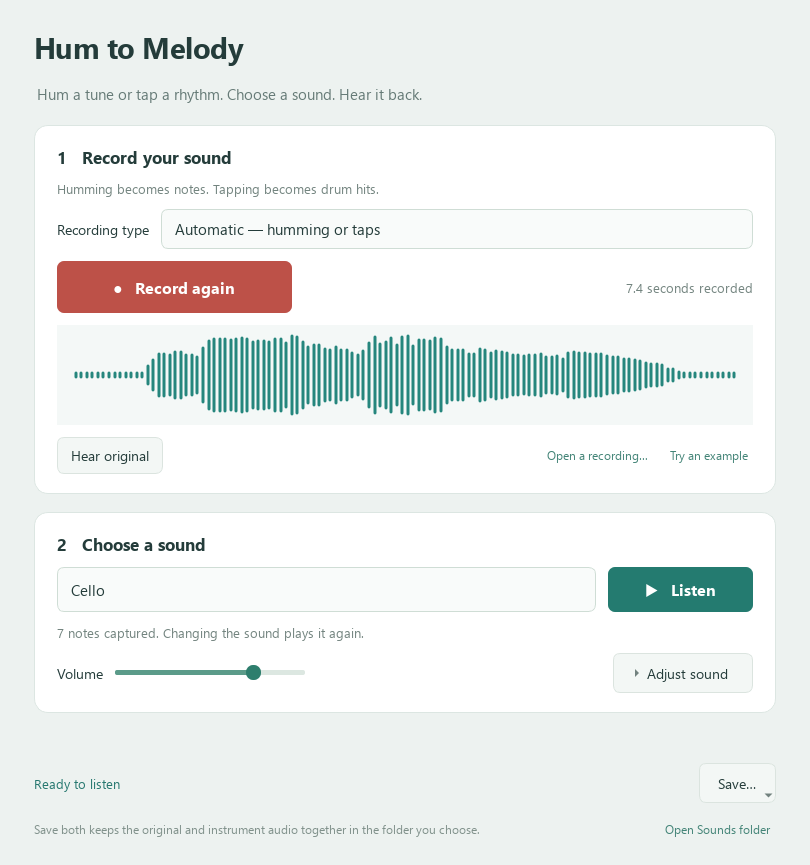

# Hum to Tune

[](https://github.com/CMadden8/hum-to-tune/actions/workflows/windows.yml)

Hum a tune into a microphone, choose an instrument and hear it play your notes. Tap a rhythm on a desk to make a percussion track. This local Windows app turns the pitch and timing of a human performance into MIDI and renders it with sampled instruments.

**Listen to one take** — [original hum · 7.4 s](demos/original-hum.wav?raw=true) · [cello · 9.0 s](demos/cello.wav?raw=true)



## Run on Windows

Install [64-bit Python 3.11](https://www.python.org/downloads/windows/) with the Windows Python launcher. Download and extract the repository or clone it. From the project folder run:

```bat
.\setup.cmd
.\Start.cmd
```

Setup creates a private Python environment and downloads the pinned pYIN plugin, FluidSynth and the MuseScore General SoundFont (about 216 MB for the SoundFont alone). Each native download is checked against its SHA-256 digest. After setup, recording and processing run locally.

Click **Try an example** to hear a twelve-note test melody without a microphone. Or click **Open a recording…** and choose `demos/original-hum.wav` to try the human performance above.

## From performance to game asset

1. Press **Record sound**, hum one melody, then press **Stop recording**. For a beat, tap instead and leave the recording type on **Automatic**, or select **Taps / percussion**.
2. Choose **Cello**, a piano, another instrument or a drum. Instrument changes replay the same detected notes or hits. Adjust octave, playback speed and reverb to taste.
3. Use **Save…** for instrument WAV, original WAV or MIDI. **Both audio files** puts the original and instrument audio side by side in the folder you choose. The default sound library is under `Music\Hum to Melody`. Sessions and automatic recordings live in `%LOCALAPPDATA%\LocalAudioTools\Hum to Melody`.

Previously called **Hum to Melody**, the app keeps its existing storage folder names so the rename preserves recordings, settings and session restoration.

## How it works

[The audio engine](src/engine.py) hosts **pYIN** through the Vamp C interface to estimate notes in a solo melody. For tapping, an energy-onset detector preserves the spacing and relative strength of hits. FluidSynth plays those events through a SoundFont. Drum MIDI uses channel 10. There are no trained models, cloud services or generated compositions in the audio path.

The app supplies the recording and preview workflow, tap detection, MIDI timing, separate audio workers and paired export. pYIN was written by Matthias Mauch at Queen Mary University of London, and instrument playback uses upstream FluidSynth and MuseScore General. See [credits and component licences](docs/engines.md).

Use an unaccompanied melody. Chords, backing music, strong vibrato and room echoes can give the note tracker an ambiguous pitch.

## Test

```powershell
$env:QT_QPA_PLATFORM = "offscreen"
.\.venv\Scripts\python.exe -m pytest -q
```

Tests check repeated notes and rests, tap timing, MIDI export, native instrument output, paired saves and preservation of the input. Setup generates the test signal and its expected notes from [this fixture](scripts/make_test_melody.py).

Application source is [GPL-3.0-or-later](LICENSE). The two [demo recordings](demos/README.md) are provided separately for listening and evaluation.
